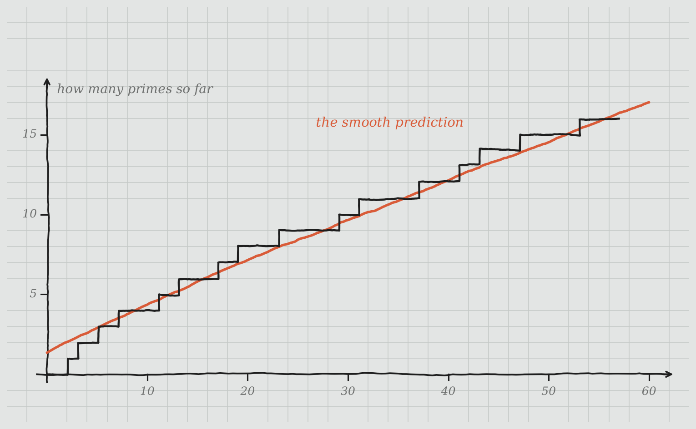
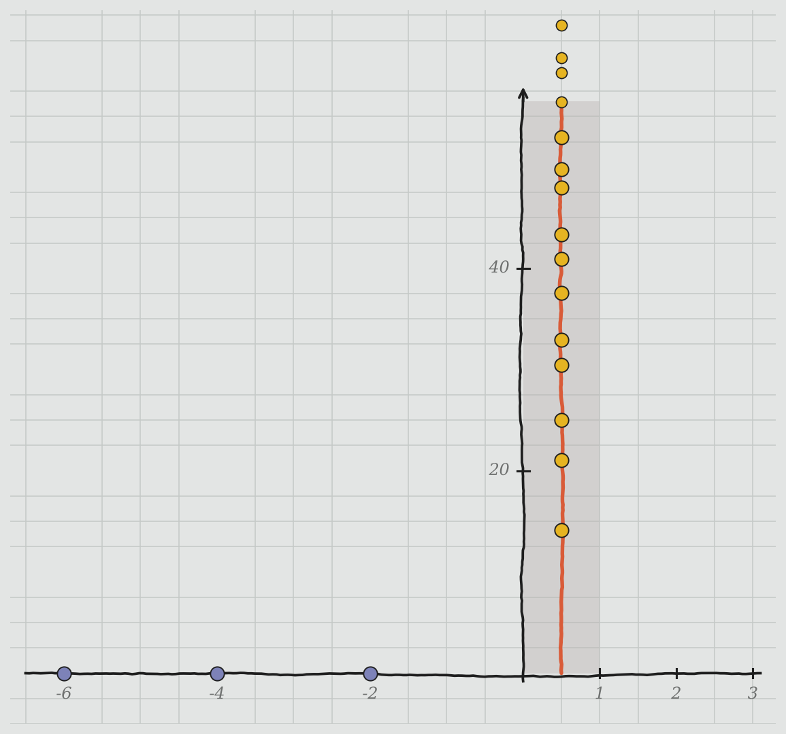

Prime numbers are one of the most fascinating parts of the mathematics from a very early time. Everything has a pattern and prime numbers are no different. I remember when I was in high-school, I needed to remember prime numbers from 0 t0 100 and my math teacher told me a phone number for that (4422322321). It has nice tick but there is no way we can find a pattern here that easily.

Look at the first few: 2, 3, 5, 7. Then a gap. 11, 13. Another gap. Sometimes two primes sit right next to each other, like 17 and 19. Other times, you can walk across thousands of numbers without finding a single one. There is no simple formula that predicts where the next prime will land.

Now if we plot a graph counting up to any given number to find how many prime numbers we have in between, we get somewhat of a staircase. Interestingly, every time we find a prime, we see that the line jumps one step and between these primes it stays flat. In the late 1700s, Carl Friedrich Gauss zoomed out. Instead of looking at individual steps, he looked at the overall slope of the staircase. He figured out that prime numbers thin out at an interesting rate which allowed him to draw a smooth curve that goes through the staircase. But the question was, 

## What is the gap between this curve and the staircase? Is it just random noise or some hidden structure?

_Superposing waves from the zeta zeros gradually snaps Gauss's smooth curve into the prime staircase._

This is where **Bernhard Riemann** entered. In 1859 he told us that this is not noise at all. It's music. What he discovered is that, we can build the exact same curve with these wobbles i.e. the staircase by adding wave to it. Just the way a synthesizer combines pure sine waves to create a complex sound. (**Stay with me..I know adding waves in a line is kinda confusing**).

Riemann used a mathematical machine called the **zeta function**. It operates on a 2D map and when you feed a point on the map that function gives you a number. What is interesting is that it will give you a zero at some very special coordinates. Every zero on that map generates a wave and that coordinate controls two things:

- How high $(t)$ it sits will set the pitch (frequency) of the wave. Smaller values will produce slow, rolling waves but higher values will give tight ripples.
- How far ($\sigma$) away on the right or left sets the loudness (Amplitude) of the wave as the numbers get larger.
  
Now we will try to debunk the addition of wave to the curve. 
Let's say we add one sine wave to it, we will get a gentle, wavy line. If we add another faster wave on top of that. Where both waves peak together, the line pushes higher; where one peaks and the other dips, they flatten each other out. When we superpose a lot of these waves, each tuned to the exact frequency dictated by that zeta function's zero, we get that step up and flatness through constructive and destructive interference. At prime numbers, those frequencies align up in phase and spike up together, which creates that vertical jump.

## The Line That Holds Everything Together

_The non-trivial zeros of the Riemann zeta function lining up along the critical line $\sigma = 1/2$._

When Riemann first calculated these few zeros by hand, he found something very eye catching. Inside a narrow vertical strip (between 0 and 1) around, $\sigma=1/2$ , we can find all the zeros there. They were not scattered and were standing perfectly in that straight line. His exact words were "*One now finds indeed approximately this number of real roots within these limits, and it is very probable that all roots are real.*"  

His famous hypothesis, which stood unsolved for 167 years until the AI-assisted proof announcement in November 2026. It is simply the claim that every single one of the infinitely many zeros stands on that exact line.

